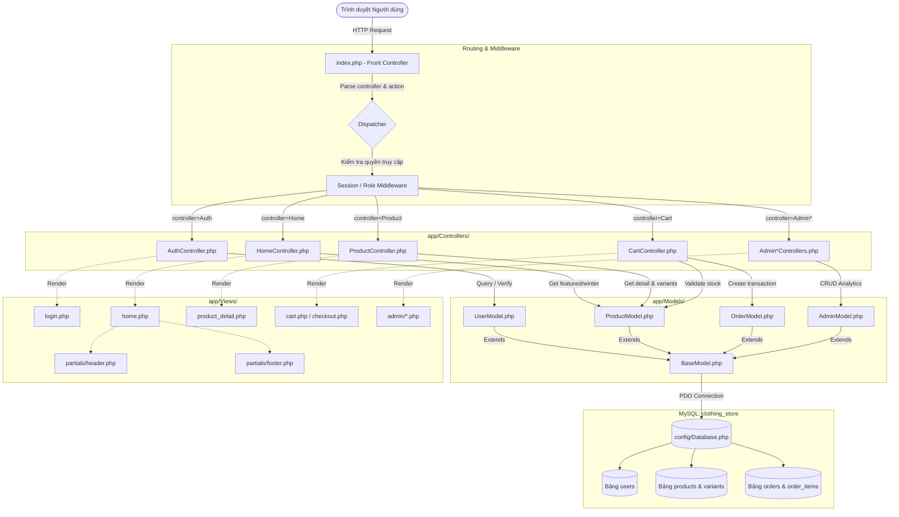
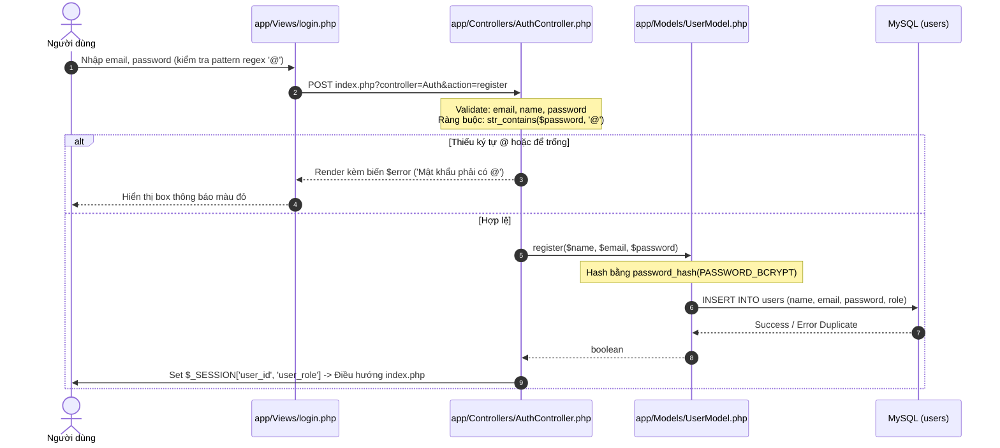

# Skill: Graphify - Trực Quan Hóa & Phân Tích Cấu Trúc Mã Nguồn

Skill này cung cấp bản đồ kiến trúc toàn diện (Architecture Call Graph, Data Flow Graph, và Component Dependency Matrix) cho hệ thống Website Bán Quần Áo MVC (`clothing_store`), giúp lập trình viên và AI Agent kiểm soát chính xác 100% vị trí logic mã nguồn và đánh giá tác động trước khi sửa đổi.

---

## 1. Bản Đồ Tổng Thể Luồng Yêu Cầu (Global Request Lifecycle)

---

## 2. Chi Tiết Đồ Thị Tính Năng Xác Thực (Authentication Flow Graph)

Khi kiểm tra hoặc sửa đổi tính năng **Đăng nhập / Đăng ký**:

---

## 3. Ma Trận Đánh Giá Tác Động (Impact Analysis Matrix)

Khi cần chỉnh sửa bất kỳ module nào, tra cứu ma trận sau để biết phạm vi ảnh hưởng (Blast Radius):

| File dự kiến sửa | Tầng phụ thuộc trực tiếp (Gọi tới) | Tầng bị ảnh hưởng (Cần test lại) | Điểm kiểm thử xung yếu |
| :--- | :--- | :--- | :--- |
| **`app/Controllers/AuthController.php`** | `UserModel.php`, `BaseController.php` | `app/Views/login.php`, `$_SESSION` | Form Login, Form Register, Chuyển hướng Role Admin/Customer |
| **`app/Models/UserModel.php`** | `BaseModel.php`, `config/Database.php` | `AuthController.php`, `ProfileController.php` | Hàm mã hóa `password_hash`, hàm `password_verify` |
| **`app/Controllers/CartController.php`** | `ProductModel.php`, `OrderModel.php` | `app/Views/cart.php`, `checkout.php` | Session giỏ hàng, trừ tồn kho trong Transaction PDO |
| **`app/Views/home.php`** | `HomeController.php`, Tailwind CSS | Toàn bộ trải nghiệm trang chủ | Hero Banner Animation, Responsive Grid sản phẩm, Link xem chi tiết |

---

## 4. Hướng Dẫn Sử Dụng Skill Này Cho AI & Developer

1. **Khi muốn thêm tính năng mới:**
   - Tra cứu sơ đồ ở Mục 1 để xác định tính năng thuộc Controller nào.
   - Viết logic Model kế thừa `BaseModel` trước, sau đó mới viết Controller và kết nối ra View.
2. **Khi debug lỗi:**
   - Đi ngược luồng Request: Xem `Error Log` ở dòng nào $\rightarrow$ Tra cứu Controller phụ trách $\rightarrow$ Kiểm tra Model và câu lệnh SQL Prepared Statement tương ứng.
