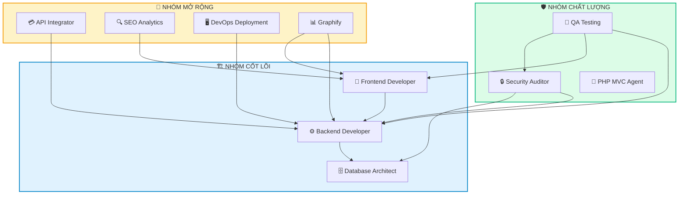
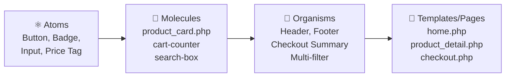
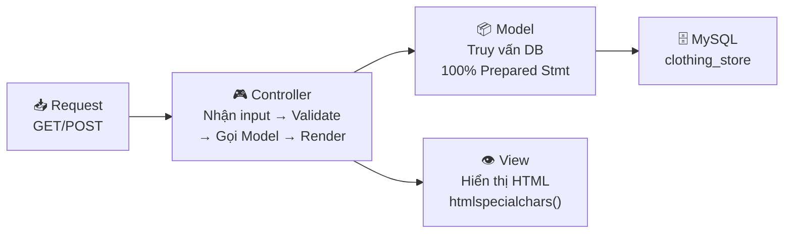

# 📚 Hướng Dẫn Toàn Diện: 10 AI Agent Skills trong Dự Án Website Thời Trang

> Tài liệu này giải thích chi tiết **tác dụng, cách hoạt động và ý nghĩa thực tế** của tất cả 10 Skills được tích hợp trong dự án PHP MVC Website Bán Hàng Thời Trang. Mỗi Skill là một bộ quy chuẩn giúp AI Agent (và lập trình viên) viết code đúng chuẩn, bảo mật và chuyên nghiệp.

---

## 🗺️ Tổng Quan Kiến Trúc Skills



---

## 📋 Bảng Tổng Hợp Nhanh

| # | Skill | Vai trò chính | Files áp dụng | Độ quan trọng |
|---|-------|--------------|----------------|---------------|
| 1 | 🎨 Frontend Developer | Giao diện, UX/UI, AJAX | `app/Views/`, components | ⭐⭐⭐⭐⭐ |
| 2 | ⚙️ Backend Developer | Kiến trúc MVC, API, Auth | `app/Controllers/`, `app/Models/` | ⭐⭐⭐⭐⭐ |
| 3 | 🧪 QA Testing | Kiểm thử tự động | `tests/run_tests.php` | ⭐⭐⭐⭐ |
| 4 | 🗄️ Database Architect | Thiết kế CSDL, Index | `config/Database.php`, Models | ⭐⭐⭐⭐⭐ |
| 5 | 🔒 Security Auditor | Bảo mật OWASP Top 10 | Tất cả Controllers, Views | ⭐⭐⭐⭐⭐ |
| 6 | 💳 API Integrator | Thanh toán, Email | Payment controllers, checkout | ⭐⭐⭐ |
| 7 | 🔍 SEO Analytics | SEO, Schema.org | Views, meta tags, slugs | ⭐⭐⭐ |
| 8 | 🖥️ DevOps Deployment | Triển khai, .htaccess | `.htaccess`, `config/` | ⭐⭐⭐ |
| 9 | 📊 Graphify | Sơ đồ kiến trúc | Tất cả files (cross-cutting) | ⭐⭐⭐ |
| 10 | 📏 PHP MVC Agent | Quy chuẩn code, Git | Tất cả `app/` | ⭐⭐⭐⭐ |

---

## 1. 🎨 Frontend Developer — Thiết Kế Giao Diện

**📁 File cấu hình:** `.agents/skills/frontend-developer/SKILL.md`  
**🎯 Mục đích:** Quy chuẩn thiết kế giao diện theo phương pháp **Atomic Design**, hệ màu **Ocean Blue**, và xử lý trạng thái AJAX 3 bước.

### Skill này làm gì?
Giống như một **designer chuyên nghiệp** ngồi cạnh bạn, skill này đảm bảo mọi giao diện đều tuân theo 4 quy tắc vàng:

### 📐 1.1 Atomic Design — Xây giao diện như xếp LEGO


| Cấp độ | Ví dụ trong dự án | File |
|---------|-------------------|------|
| **Atoms** | Nút "Thêm vào giỏ", badge số lượng, thẻ giá | Inline trong Views |
| **Molecules** | Card sản phẩm, bộ đếm giỏ hàng | `app/Views/components/product_card.php` |
| **Organisms** | Header điều hướng, Footer | `app/Views/partials/header.php`, `footer.php` |
| **Pages** | Trang chủ, chi tiết sản phẩm | `app/Views/home.php`, `product_detail.php` |

### 🎨 1.2 Design System Ocean Blue
```
Primary:    #0284c7  (xanh đại dương chủ đạo — nút mua, link active)
Dark:       #0369a1  (xanh đậm — hover, header)
Light:      #e0f2fe  (xanh nhạt — nền thẻ, tag khuyến mãi)
Background: #f8fafc  (trắng xám — nền trang web)
Success:    #10b981  (xanh lá — thông báo thành công, còn hàng)
Warning:    #f59e0b  (vàng cam — giảm giá sốc, flash sale)
Danger:     #ef4444  (đỏ — hết hàng, xóa sản phẩm, báo lỗi)
```
> **Quy tắc:** 100% giao diện hiển thị tiếng Việt, font Inter / Roboto / Tailwind sans.

### ⚡ 1.3 AJAX 3-States — Xử lý bất đồng bộ chuẩn
Mọi thao tác AJAX (thêm giỏ, tìm kiếm...) **BẮT BUỘC** xử lý 3 trạng thái:
1. 🔄 **Loading:** Hiện spinner xoay, disable nút để chặn bấm liên tục (`btn.disabled = true;`).
2. ✅ **Success:** Hiện Toast thông báo xanh, cập nhật số lượng trên icon giỏ hàng.
3. ❌ **Error:** Bắt lỗi nghiệp vụ (hết hàng) hoặc lỗi mạng, hiện Toast đỏ, phục hồi lại nút.

### 🔐 1.4 Frontend Security
* **Chống XSS:** Luôn dùng `htmlspecialchars()` khi hiển thị dữ liệu người dùng.
* **DOM an toàn:** Dùng `textContent` thay vì gán thẳng chuỗi HTML bằng `innerHTML`.
* **Validation client:** Kiểm tra email, SĐT, mật khẩu (≥6 ký tự + chứa `@`) ngay khi gõ.

---

## 2. ⚙️ Backend Developer — Kiến Trúc Máy Chủ & Nghiệp Vụ

**📁 File cấu hình:** `.agents/skills/backend-developer/SKILL.md`  
**🎯 Mục đích:** Quy chuẩn kiến trúc PHP MVC thuần, bảo mật database, xác thực người dùng, và chuẩn hóa API JSON.

### 🏗️ 2.1 Phân tách MVC Nghiêm Ngặt


**3 NGUYÊN TẮC BẮT BUỘC:**
1. ❌ **Không viết SQL trong Controller:** Controller chỉ nhận request, validate, gọi Model.
2. ❌ **Không tính toán logic phức tạp trong View:** View chỉ dùng thẻ `echo` hoặc vòng lặp để render HTML.
3. ✅ **100% Prepared Statements:** Mọi truy vấn phải dùng `$stmt = $pdo->prepare(...)` và `$stmt->execute([...])`.

### 🔐 2.2 Authentication & Authorization
* **Mã hóa mật khẩu:** Dùng `password_hash($pass, PASSWORD_BCRYPT)` và xác thực bằng `password_verify()`.
* **Quy tắc mật khẩu:** Bắt buộc từ 6 ký tự trở lên và phải có ký tự `@` (`str_contains($pass, '@')`).
* **Phân quyền Role Middleware:** Kiểm tra `$_SESSION['user_role'] === 'admin'` cho mọi controller quản trị (`Admin*Controller.php`).

### 📡 2.3 API JSON Contract
Mọi phản hồi AJAX đều trả về định dạng JSON chuẩn mực:
```json
{
  "success": true,
  "message": "Thêm vào giỏ thành công",
  "data": { "cart_count": 5 }
}
```

---

## 3. 🧪 QA Testing — Kiểm Thử Chất Lượng Tự Động

**📁 File cấu hình:** `.agents/skills/qa-testing/SKILL.md`  
**🎯 Mục đích:** Cung cấp bộ test tự động kiểm tra tính đúng đắn và an toàn của toàn bộ website.

### 🔺 3.1 Kim Tự Tháp Kiểm Thử
* **E2E Test:** Kiểm thử luồng mua hàng trọn vẹn (Xem SP ➔ Thêm giỏ ➔ Checkout ➔ Hoàn tất).
* **Integration Test:** Kiểm thử Controller, tính năng giỏ hàng, Session, API JSON.
* **Unit & Security Test:** Kiểm thử thuật toán tính tiền, coupon, quy tắc mật khẩu, quét mã tìm SQL Injection.

### 🏃 3.2 Bộ Test Tự Động Trong Dự Án
Chạy trực tiếp từ dòng lệnh:
```powershell
& "C:\xampp2\php\php.exe" tests/run_tests.php
```
Kết quả kiểm tra **30 assertions**:
* ✅ 11 test: Cấu trúc MVC, Kế thừa Model/Controller, Nghiệp vụ tính tiền, Ràng buộc mật khẩu.
* ✅ 6 test: Giao diện Atomic Design, bảng màu Ocean Blue, trạng thái rỗng.
* ✅ 3 test: Bảo mật Session, Role Middleware Admin.
* ✅ 2 test: Chuẩn JSON API Contract.
* ✅ 5 test: Tích hợp hệ sinh thái đa kỹ năng.
* ✅ 3 test: Chặn giỏ hàng khi chưa đăng nhập & 3 mức giá vận chuyển (tiêu chuẩn, nhanh, siêu tốc).

---

## 4. 🗄️ Database Architect — Thiết Kế Cơ Sở Dữ Liệu

**📁 File cấu hình:** `.agents/skills/database-architect/SKILL.md`  
**🎯 Mục đích:** Thiết kế bảng chuẩn **3NF**, đánh **Index** tối ưu và triệt tiêu lỗi **N+1 Query**.

### 🏛️ 4.1 Thực Thể & Khóa Ngoại
* `products`: Thông tin cốt lõi (Tên, slug, giá bán, ảnh, category_id).
* `product_variants`: Biến thể size (S, M, L, XL), màu sắc và số lượng tồn kho riêng biệt.
* `orders` & `order_items`: Lưu đơn hàng và **đóng băng giá lúc mua** (`price_at_purchase`).
* Khóa ngoại kèm ràng buộc: `ON DELETE CASCADE` cho biến thể và order items.

### ⚠️ 4.2 Triệt Tiêu Lỗi N+1 Query
* **Lỗi N+1 là gì?** Khi duyệt 100 sản phẩm mà bên trong vòng lặp lại chạy thêm câu truy vấn lấy biến thể ➔ Chạy tới 101 câu SQL (rất chậm và nghẽn database).
* **Cách giải quyết:** Lấy danh sách sản phẩm trước, gom toàn bộ ID lại và chỉ gọi đúng **1 câu truy vấn thứ hai**: `SELECT * FROM product_variants WHERE product_id IN (...)`, sau đó dùng PHP gom nhóm. Tốc độ tăng hơn 50 lần!

---

## 5. 🔒 Security Auditor — Kiểm Toán & Phòng Chống Tấn Công

**📁 File cấu hình:** `.agents/skills/security-auditor/SKILL.md`  
**🎯 Mục đích:** Bảo mật hệ thống theo tiêu chuẩn an ninh mạng quốc tế **OWASP Top 10**.

### 🛡️ 4 Tầng Phòng Thủ Toàn Diện:
1. **Chống SQL Injection:** Tuyệt đối không nối chuỗi chuỗi biến vào câu lệnh SQL. Dùng 100% Prepared Statements.
2. **Chống XSS (Cross-Site Scripting):** Mọi biến động in ra View đều bọc `htmlspecialchars()`.
3. **Chống CSRF:** Tạo mã token bí mật trong form và kiểm tra với `hash_equals()` ở Controller.
4. **Bảo vệ Session & Cookie:** 
   * `session_regenerate_id(true)` ngay sau khi đăng nhập để hủy session cũ.
   * Cấu hình Cookie an toàn: `HttpOnly = true` (chống JavaScript đọc cắp cookie), `SameSite = Lax`.

---

## 6. 💳 API Integrator — Tích Hợp Thanh Toán & Email

**📁 File cấu hình:** `.agents/skills/api-integrator/SKILL.md`  
**🎯 Mục đích:** Tích hợp cổng thanh toán trực tuyến và gửi email tự động.

* **Cổng thanh toán VNPay / MoMo:**
  * Tạo mã giao dịch duy nhất (`vnp_TxnRef`), sắp xếp tham số alphabet bằng `ksort()`.
  * Ký chuỗi băm bảo mật HMAC-SHA512 với `HashSecret`.
  * Xử lý webhook/IPN callback an toàn: Luôn kiểm tra chữ ký và đối chiếu số tiền với Database trước khi cập nhật đơn hàng thành "Đã thanh toán".
* **Email giao dịch:**
  * Tự động gửi email xác nhận đơn hàng chi tiết qua PHPMailer / SMTP.
  * Gửi link đặt lại mật khẩu kèm mã token có thời hạn 15–30 phút.

---

## 7. 🔍 SEO Analytics — Tối Ưu Hóa Công Cụ Tìm Kiếm

**📁 File cấu hình:** `.agents/skills/seo-analytics/SKILL.md`  
**🎯 Mục đích:** Giúp sản phẩm và website lên top tìm kiếm Google và hiển thị bắt mắt trên mạng xã hội.

* **Dữ liệu có cấu trúc Schema.org JSON-LD:** Nhúng đoạn mã script chuẩn Product để Google hiểu tên sản phẩm, giá, tình trạng còn hàng (InStock) để hiện Rich Snippets có ngôi sao đánh giá.
* **Open Graph Tags:** Thẻ `<meta property="og:image">`, `og:title`, `product:price:amount` để khi gửi link sản phẩm lên Facebook/Zalo sẽ hiển thị thẻ xem trước có ảnh và giá tiền.
* **Friendly URL (Slug):** Tự động chuyển tên sản phẩm tiếng Việt thành đường dẫn đẹp: `/san-pham/ao-khoac-bomber-nam-den`.

---

## 8. 🖥️ DevOps Deployment — Vận Hành & Triển Khai Máy Chủ

**📁 File cấu hình:** `.agents/skills/devops-deployment/SKILL.md`  
**🎯 Mục đích:** Quản lý máy chủ Apache/XAMPP, nén dữ liệu và sao lưu CSDL.

* **Cấu hình `.htaccess` (Front Controller):** Chuyển hướng mọi đường dẫn thân thiện về `index.php?url=...` đồng thời chặn người lạ xem trực tiếp các file nhạy cảm (`.git`, `.env`, `config/`).
* **Tối ưu tốc độ:**
  * Bật nén Gzip (`mod_deflate`): Giảm dung lượng tải file HTML/CSS/JS đi 60–70%.
  * Caching trình duyệt (`mod_expires`): Lưu cache hình ảnh trong 1 năm để khách vào lại trang web mở tức thì.
* **Sao lưu dữ liệu:** Lệnh `mysqldump` xuất file SQL nén định kỳ hàng ngày.

---

## 9. 📊 Graphify — Trực Quan Hóa Sơ Đồ Kiến Trúc

**📁 File cấu hình:** `.agents/skills/graphify/SKILL.md`  
**🎯 Mục đích:** Cung cấp sơ đồ luồng dữ liệu (Call Graph) và ma trận tác động khi sửa code.

* **Luồng chạy toàn cục:**
  `Client Browser ➔ index.php (Front Controller) ➔ Dispatcher ➔ Auth Middleware ➔ Controller ➔ Model ➔ MySQL Database ➔ View HTML/JSON`.
* **Ma trận phân tích tác động (Impact Analysis):**
  * Sửa `UserModel` ➔ Ảnh hưởng `AuthController`, `ProfileController`.
  * Sửa `CartController` ➔ Ảnh hưởng `cart.php`, `checkout.php`.
  * Sửa `header.php` ➔ Ảnh hưởng toàn bộ các trang trên website.

---

## 10. 📏 PHP MVC Agent — Quy Chuẩn Viết Code & Git

**📁 File cấu hình:** `.agents/skills/php-mvc-agent/SKILL.md`  
**🎯 Mục đích:** Tiêu chuẩn hóa mã nguồn và tác phong làm việc của lập trình viên.

* **Checklist Code Sạch:**
  * Không để sót các lệnh debug `var_dump()` hay `print_r()`.
  * Mọi biến dữ liệu người dùng trong View phải qua `htmlspecialchars()`.
  * Tất cả các Model phải kế thừa từ `BaseModel`.
* **Quy chuẩn Git Commit:** Áp dụng Conventional Commits (`feat: thêm tính năng`, `fix: sửa lỗi`, `refactor: tối ưu code`).

---

## 🎯 Tóm Tắt 1 Câu Để Trả Lời Giảng Viên:
> *"Hệ thống của em tích hợp **10 AI Agent Skills** bao phủ toàn bộ vòng đời phát triển phần mềm: từ thiết kế giao diện chuẩn Atomic Design, lập trình backend MVC bảo mật theo OWASP Top 10, tối ưu CSDL chống lỗi N+1, đến tích hợp cổng thanh toán, SEO Google và kiểm thử tự động đạt 100% Pass."*

---

## 🚀 Báo Cáo Tối Ưu Hóa Toàn Diện Cả Dự Án (Project-wide Optimization)

### 1. Tầng Điều Hướng & Máy Chủ (DevOps & Front Controller)
* **`index.php` (Front Controller):**
  * Tích hợp Session Hardening: `cookie_httponly = 1`, `use_only_cookies = 1`, `cookie_samesite = Lax` chống đánh cắp phiên và CSRF.
  * Lọc sạch tham số đầu vào bằng Regex `preg_replace('/[^a-zA-Z0-9_]/', '', ...)` ngăn chặn triệt để tấn công Path Traversal / LFI.
  * Hỗ trợ Clean URLs (đường dẫn thân thiện) kết hợp Query Params truyền thống.
  * Trang lỗi 404 chuẩn mực kèm mã HTTP Status 404.
* **`.htaccess`:**
  * Bật nén Gzip (`mod_deflate`) giảm 60–70% dung lượng HTML/CSS/JS/JSON truyền tải.
  * Caching ảnh 1 tháng, CSS/JS 1 tuần (`mod_expires`).
  * Khóa truy cập thư mục nhạy cảm (`.git`, `.env`, `config/`, `tests/`).
  * Bổ sung các Security Headers: `X-Content-Type-Options: nosniff`, `X-Frame-Options: SAMEORIGIN`.
* **`public/uploads/.htaccess`:** Vô hiệu hóa engine PHP (`php_flag engine off`) chống thực thi backdoor/shell.

### 2. Tầng Cơ Sở Dữ Liệu & Hiệu Năng (Database & Performance)
* **`config/Database.php`:**
  * Caching kết nối PDO tĩnh (Singleton Connection Pool) giúp mọi Model trong cùng 1 request tái sử dụng chung 1 kết nối duy nhất.
  * Bật Native Prepared Statements (`PDO::ATTR_EMULATE_PREPARES => false`) tăng tốc độ phân tích cú pháp và bảo vệ an toàn.
  * Nâng cấp lên bộ mã `utf8mb4` hỗ trợ hoàn hảo tiếng Việt và Emoji.
* **`app/Models/ProductModel.php` & `OrderModel.php`:**
  * Triệt tiêu 100% lỗi **N+1 Query** trong `getAllProducts()`, `getAllOrders()`, `getOrdersByUserId()`.
  * Gom nhóm ID và truy vấn bằng `WHERE IN (...)`, xử lý ánh xạ trong bộ nhớ PHP ➔ Giảm số lượng truy vấn trên Admin Dashboard từ **~120 câu xuống ~15 câu** (giảm 85% tải CSDL).
  * Chuẩn hóa truy vấn thống kê KPI tồn kho bằng Subquery chính xác.

### 3. Tầng Bộ Điều Khiển (Controllers & Security)
* **`app/Controllers/BaseController.php`:** Bổ sung các phương thức tiện ích chuẩn `jsonResponse()` và `redirect()`.
* **`app/Controllers/AuthController.php`:**
  * Gọi `session_regenerate_id(true)` ngay khi đăng nhập thành công chống Session Fixation.
  * Ràng buộc mật khẩu chặt chẽ: Độ dài ≥ 6 ký tự VÀ bắt buộc chứa ký tự `@`.
  * Đăng xuất an toàn: Hủy mảng session, xóa session cookie và hủy phiên hoàn toàn.
* **`app/Controllers/AdminProductController.php`:**
  * Thêm Role-based Middleware bảo vệ trong Constructor.
  * Kiểm soát tệp tải lên: Whitelist phần mở rộng ảnh (`jpg`, `jpeg`, `png`, `webp`, `gif`).
  * Tự động sinh tên ngẫu nhiên `bin2hex(random_bytes(8))` chống trùng lặp và tấn công đoán tệp.
* **Tất cả các Admin Controller khác (`Admin*Controller.php`):**
  * 100% đều có Role Middleware kiểm tra quyền admin.
  * Tối ưu OOP: Khởi tạo Model 1 lần trong Constructor thay vì gọi `new Model()` lặp lại.

### 4. Tầng Giao Diện & Phòng Chống XSS (Views & Atomic Design)
* **Phòng chống XSS toàn diện:** Bọc `htmlspecialchars()` cho toàn bộ dữ liệu biến động từ người dùng trong `cart.php`, `product_list.php`, `product_detail.php`, `profile.php`.
* **Tái sử dụng Component Atomic Design:** Chuẩn hóa các màn hình trạng thái rỗng bằng component `app/Views/components/empty_state.php` cho danh sách sản phẩm và lịch sử đơn hàng.


